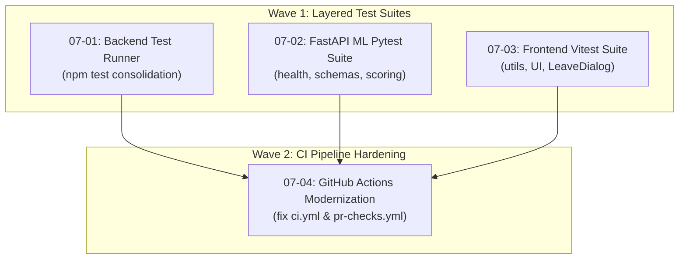

# Phase 7: Automated Test Coverage & CI Hardening

## Overview
Phase 7 elevates the INTELLI BOT platform from individual manual testing scripts to a unified, multi-layer automated testing ecosystem backed by continuous integration.

## Wave Execution Structure

## Detailed Plan Summary

### Wave 1 (Parallel Independent Suites)
- **[07-01-PLAN.md](file:///c:/Users/sattu/Documents/Programing%20Coding/SkillvSyncGD/RoxGD/.planning/phases/07-automated-test-coverage-ci-hardening/07-01-PLAN.md):**
  Consolidates `test-signaling.js`, `test-reports.js`, `test-history.js`, and `test-integration.js` into a cross-platform ESM runner in `server/package.json` callable via `npm test`.
- **[07-02-PLAN.md](file:///c:/Users/sattu/Documents/Programing%20Coding/SkillvSyncGD/RoxGD/.planning/phases/07-automated-test-coverage-ci-hardening/07-02-PLAN.md):**
  Adds `pytest`, `pytest-asyncio`, and `httpx` to `ml-server/` with automated tests covering `/health`, Pydantic schemas, and audio prosody calculations.
- **[07-03-PLAN.md](file:///c:/Users/sattu/Documents/Programing%20Coding/SkillvSyncGD/RoxGD/.planning/phases/07-automated-test-coverage-ci-hardening/07-03-PLAN.md):**
  Introduces Vitest and React Testing Library to `client/`, adding unit tests for utility functions and UI components with `npm test`.

### Wave 2 (Orchestration & Verification)
- **[07-04-PLAN.md](file:///c:/Users/sattu/Documents/Programing%20Coding/SkillvSyncGD/RoxGD/.planning/phases/07-automated-test-coverage-ci-hardening/07-04-PLAN.md):**
  Remedies legacy paths in `.github/workflows/ci.yml` and `pr-checks.yml`, wires all test suites into CI gates, maps correct environment variables (`ML_SERVER_URL`), and disables failure masking.

## Success Criteria
- [ ] Backend: `cd server && npm test` runs and passes.
- [ ] ML Service: `cd ml-server && pytest` runs and passes.
- [ ] Frontend: `cd client && npm test` runs and passes.
- [ ] CI: `.github/workflows/ci.yml` and `pr-checks.yml` validate clean with no dead path references.
